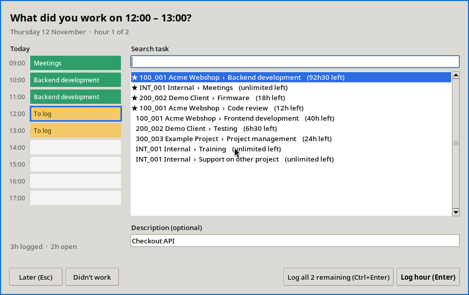

# tl-uurtjes

A small popup that asks every hour which Teamleader Orbit task you worked on, and logs it for you.



## Install

Needs Linux with systemd and [uv](https://docs.astral.sh/uv/).

```bash
git clone https://github.com/StijnVergouwen/tl_uurtjes.git
cd tl_uurtjes
./install.sh   # logs you in to Orbit, asks your working hours, starts the hourly timer
```

## Use

The column on the left shows your day: green = logged (with the task name), yellow = still to log,
grey = didn't work, blank = still to come. The hour you're answering is outlined.

| Key | Action |
|---|---|
| type, ↑/↓ | find a task (★ = recently used) |
| **Enter** | log this hour |
| **Ctrl+Enter** | log all open hours on this task |
| **Didn't work** | leave this hour empty, it won't ask again |
| **Esc** | later; open hours come back at the next popup |

## Good to know

- Change your hours any time: `uv run tl-uurtjes setup`
- Missed popup (laptop asleep)? You get one as soon as it wakes up. Only today's hours are asked.
- Time you already logged in Orbit is respected, and the same task as the hour before extends that entry.
- Moved the repo? Run `./install.sh` again.
- "Not logged in"? Run `uv run tl-uurtjes login`. Popup never shows up? See `journalctl --user -u tl-uurtjes`.

## Development

```bash
uv run pytest
TL_UURTJES_DRY_RUN=1 TL_UURTJES_NOW="2026-11-12 14:05" uv run tl-uurtjes   # no writes, fake clock
```
